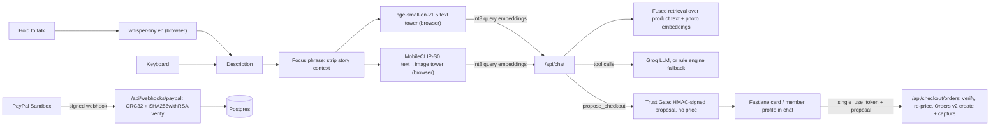

# Visio

**Describe it. We'll find it.**

Visio is a natural-language shopping agent for the PayPal AI Hackathon 2026 ("Best Use of Agentic Commerce"). You saw something in a film, an ad or a reel. Say or type what you remember, in your own words: "the matte silver over-ear headphones the android wears while staring out the rainy window". Models running in your browser match the description against every product's text and photo. Refine it in conversation, then check out with **Fastlane by PayPal** inside the chat. A **Trust Gate** keeps the AI from ever moving money on its own.

## What you can do

1. **Talk or type.** Hold the mic button, or hold <kbd>Space</kbd>, speak, and release. Whisper transcribes on your device and the description is sent at once, Wispr Flow style. Typing works too.
2. **See why it matched.** Every result shows a match score with its semantic (text), visual (photo) and category signals. "How Visio matched this" opens the focus phrase, the category posterior, the filters, and per-model timings.
3. **Refine in plain language:** "in black", "under $300", "cheaper", "with a leather strap". Short follow-ups refine the previous description. A new description starts a new search.
4. **Buy.** Tap **Buy** or say "buy #1". The agent proposes a checkout card, you confirm with Fastlane, and the order shows as paid only after a signature-verified PayPal webhook.

## Architecture



### Description matching (`lib/encoders.ts`, `lib/focus.ts`, `lib/retrieval.ts`)

All three models run in the browser through Transformers.js (ONNX, int8), are downloaded once and then cached. Your voice and text are never sent to a model server. Only the user's message and two small int8 embeddings go to `/api/chat`.

- **Focus phrase.** Cinematic descriptions mix the product with the story ("…the courier wears in the chase scene"). `focusPhrase` strips context clauses, so "the scooter he rides through the neon alley" becomes "the scooter".
- **Text tower:** `Xenova/bge-small-en-v1.5` (384-d, CLS pooling, query instruction). The query vector is the normalized sum of the full sentence and its focus phrase. Products are embedded from title, brand, category, tags and description.
- **Vision-language tower:** `Xenova/mobileclip_s0` (512-d). The focus phrase is matched against **product photos** embedded by the MobileCLIP image encoder, which catches visual attributes that product copy leaves out.
- **Category posterior:** a nearest-centroid classifier, a softmax over BGE category centroids, gives \(P(c \mid q)\).
- **Fusion:**

\[
s(p) = 0.8\,z(\cos(q_{t}, d_p)) + 0.2\,z(\cos(q_{v}, i_p)) + 0.6\,P(c_p \mid q) + 0.35\,[\text{color match}]
\]

  Each cosine is z-scored over the catalog because the two towers' raw similarities live on different scales. Budgets are hard filters. Results must stay within 1.8 of the best catalog-wide score, so "under $50" returns nothing rather than padding the results with unrelated items.
- **Weights** were tuned on the labeled set in `scripts/eval-queries.ts`. The fused ranker gets **19/20 top-1 and 20/20 top-3** on cinematic descriptions.
- **Index:** exact cosine search over 194 products in `data/embeddings.json` (int8). At this size that is equivalent to a FAISS `IndexFlatIP`.

### Voice (`lib/asr.ts`, `components/flow-bar.tsx`)

- `MediaRecorder` records while the button or Space is held.
- An `AnalyserNode` drives the live waveform.
- The audio is resampled to 16 kHz mono with an `OfflineAudioContext` and transcribed by `Xenova/whisper-tiny.en`.
- Whisper downloads lazily on the first press. Esc cancels.

### Conversational core (`lib/agent.ts`)

- **With `GROQ_API_KEY`:** a Groq-hosted LLM (`llama-3.3-70b-versatile` by default) uses two tools.
  - `search_catalog {refine, color, max_price_usd}` runs the fused retrieval on the browser's embeddings.
  - `propose_checkout {product_id, quantity}` can only reference products already shown.
- **Without a key, or if Groq fails:** a deterministic rule engine (`lib/intent.ts`) handles refinements, budgets, "cheaper" and "buy #N".
- The LLM never sees prices it can change.

### Trust Gate (`lib/trust-gate.ts`, `app/api/checkout/orders/route.ts`)

1. `propose_checkout` returns a **TransactionProposal** `{pid, qty, nonce, exp}` signed with HMAC-SHA256. It carries no price.
2. When you tap, the server checks the signature (constant-time), the 15-minute expiry and the single-use nonce (a unique column in Postgres). It then **recomputes the amount from the catalog**.
3. A PayPal **Orders v2** order is created with the Fastlane `single_use_token`, `intent: CAPTURE`, and a `PayPal-Request-Id` for idempotency.
4. `/api/webhooks/paypal` verifies `transmission_id|transmission_time|webhook_id|crc32(raw body)` with SHA256withRSA against a certificate fetched only from PayPal hosts.
   - Stale or replayed transmissions are rejected.
   - Only `PAYMENT.CAPTURE.COMPLETED` marks an order `paid`.

## PayPal and AI tools used

| Tool | Role |
| --- | --- |
| Fastlane by PayPal (JS SDK, Sandbox) | Email lookup, OTP member auth, card component, watermark |
| PayPal OAuth 2.0 | Server access token and domain-scoped `sdk_init` client token |
| PayPal Orders v2 API | Create and capture orders from server-side catalog prices |
| PayPal Webhooks | Signature-verified capture events; the only path to "paid" |
| BGE small (BAAI) | Semantic text embeddings for descriptions and products |
| MobileCLIP (Apple) | Text-to-image matching against product photos |
| Whisper tiny.en (OpenAI) | On-device push-to-talk transcription |
| Groq | Low-latency LLM tool calling for refinements and checkout proposals |

## Run it locally

Requirements: Node 22+.

```bash
npm install
npm run dev          # http://localhost:4317
```

No keys are needed: the app uses an in-memory PGlite database, the rule engine and a clearly labeled demo checkout. To use the real integrations, copy `.env.example` to `.env.local` and fill in:

- `PAYPAL_CLIENT_ID` / `PAYPAL_CLIENT_SECRET`: a **Sandbox** REST app with Advanced Card Payments enabled (required for Fastlane).
- `PAYPAL_WEBHOOK_ID`: a webhook in the same Sandbox app pointing at `https://<your-host>/api/webhooks/paypal`.
  - Subscribe it to `PAYMENT.CAPTURE.COMPLETED`, `PAYMENT.CAPTURE.DENIED` and `CHECKOUT.ORDER.COMPLETED`.
  - To test locally, expose the port with a tunnel.
- `GROQ_API_KEY`: from the Groq console.

To test a Sandbox payment, use any email for a guest checkout and a card from PayPal's [Sandbox card testing page](https://developer.paypal.com/tools/sandbox/card-testing/) (for example `4111 1111 1111 1111`), with any future expiry and any CVV.

### Scripts

| Command | What it does |
| --- | --- |
| `npm test` | Vitest: Trust Gate, webhook signatures, intent and refinement parsing, focus phrases, fused retrieval |
| `npm run lint` / `npm run typecheck` | ESLint / TypeScript |
| `npx tsx scripts/eval-queries.ts --verbose` | Labeled retrieval eval (fused vs text-only, top-1 / top-3) |
| `npx tsx scripts/smoke-chat.ts "the silver headphones the android wears" "in black" "buy #1"` | End-to-end smoke test against a running server, including a demo order, replay and tamper checks |
| `npm run catalog` | Rebuild `data/catalog.json`, thumbnails, and the product text, photo and category embeddings |
| `npm run build` | Next.js build, then Postgres migrations when `DATABASE_URL` is set |

## Data and credits

- Product data and images: the [DummyJSON](https://dummyjson.com) sample catalog (194 products, 24 categories).
- Payments run only in the PayPal Sandbox. No real money moves.

## Hackathon scope

Everything in this repo was built in the hackathon window.

- **Production design:** larger encoders (SigLIP 2 for the vision-language tower) and FAISS on NVIDIA L40S GPUs, for catalogs with millions of items.
- **This tryout:** compact models in the browser, so it runs anywhere with no GPU and no inference bill, and your voice never leaves your device.

## License

MIT
