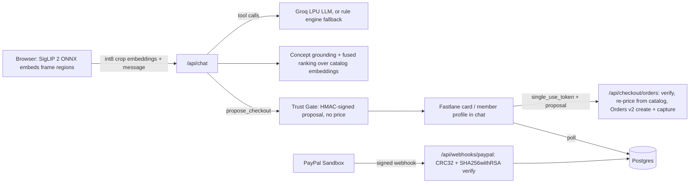

# Visio

**See it in the scene. Own it in one tap.**

Visio is a multimodal shopping agent for the PayPal AI Hackathon 2026 ("Best Use of Agentic Commerce"). Upload a frame from a film, an AI short or a Pinterest pin, or describe what you saw. Visio finds the object, matches it to a product catalog, and checks you out with **Fastlane by PayPal** inside the chat. A **Trust Gate** keeps the AI from ever moving money on its own.

## What you can do

1. Pick a sample scene or upload a screenshot. SigLIP 2 runs **in your browser**, so the image never leaves your device; only embeddings are sent to the server.
2. Visio lists the objects it sees and highlights the one it's matching. Tap another object, drag a box around anything, or describe it ("the silver headphones she's wearing").
3. Refine in plain language: "something cheaper", "in black", "under $150", "show me the lamp instead".
4. Say "buy #1" or tap **Buy**. The agent proposes a checkout card. You confirm with Fastlane, and the order shows as paid only after a signature-verified PayPal webhook arrives.

## Architecture



### Perception (`lib/perception.ts`, `lib/crops.ts`, `lib/search.ts`)

- **Model:** `google/siglip2-base-patch16-224` (ONNX, int8) via Transformers.js, the same checkpoint and quantization used to precompute the catalog in `scripts/build-embeddings.ts`.
- **Localization:** multi-scale **square** windows (full height, 1/2 and 1/3 height, overlapping) so wide 2.39:1 frames aren't squashed into a 224×224 input. Each window is scored against SigLIP 2 text embeddings of a concept vocabulary (`"a photo of a {color} {object}"`, 440 prompts) with contrast against the frame mean.
- **Ranking:** \( s(p) = \alpha\, z(\cos(v_{obj}, e^{img}_p)) + (1-\alpha)\, z(\cos(q, e^{img}_p) + \cos(v_{obj}, e^{txt}_p)) \) plus a same-object bonus. Each signal is z-scored over the catalog because image-image and image-text cosines live on very different scales in SigLIP.
- **Index:** exact cosine search over 93 products, stored as int8 vectors in `data/embeddings.json`. At this size that's equivalent to a FAISS `IndexFlatIP`. The production design swaps in FAISS on GPU for large catalogs.

### Conversational core (`lib/agent.ts`)

- With `GROQ_API_KEY` set, a Groq-hosted LLM (`llama-3.3-70b-versatile` by default) runs OpenAI-style tool calling with two tools: `find_products` (object enum, color, budget) and `propose_checkout`.
- Without a key, or if Groq fails, a deterministic rule engine (`lib/intent.ts`) takes over, so the demo never stalls.
- No text from the uploaded image reaches the LLM, and the LLM's output can never set a price.

### Trust Gate (`lib/trust-gate.ts`, `app/api/checkout/orders/route.ts`)

1. `propose_checkout` returns a **TransactionProposal** `{pid, qty, nonce, exp}` signed with HMAC-SHA256. It carries no price and only covers products already shown to the user.
2. On the user's tap, the server checks the signature (constant-time), the 15-minute expiry and the single-use nonce (a unique column in Postgres). It then **recomputes the amount from the catalog**.
3. The PayPal **Orders v2** order is created with the Fastlane `single_use_token`, `intent: CAPTURE`, and a `PayPal-Request-Id` for idempotency.
4. `/api/webhooks/paypal` verifies `transmission_id|transmission_time|webhook_id|crc32(raw body)` with SHA256withRSA against a certificate fetched only from PayPal API hosts. It rejects stale or replayed transmissions. Only `PAYMENT.CAPTURE.COMPLETED` marks an order `paid`.

## PayPal and AI tools used

| Tool | Role |
| --- | --- |
| Fastlane by PayPal (JS SDK, Sandbox) | Email lookup, OTP member auth, card component, watermark |
| PayPal OAuth 2.0 | Server access token and domain-scoped `sdk_init` client token |
| PayPal Orders v2 API | Create and capture orders from server-side catalog prices |
| PayPal Webhooks | Signature-verified capture events; the only path to "paid" |
| Google SigLIP 2 | Image and text embeddings for localization and matching |
| Groq | Low-latency LLM tool calling for intent and checkout proposals |

## Run it locally

Requirements: Node 22+.

```bash
npm install
npm run dev          # http://localhost:4317
```

No keys are needed: the app uses an in-memory PGlite database, the rule engine and the demo checkout. To use the real integrations, copy `.env.example` to `.env.local` and fill in:

- `PAYPAL_CLIENT_ID` / `PAYPAL_CLIENT_SECRET`: a **Sandbox** REST app with Advanced Card Payments enabled (required for Fastlane).
- `PAYPAL_WEBHOOK_ID`: create a webhook in the same Sandbox app pointing at `https://<your-host>/api/webhooks/paypal` and subscribe to `PAYMENT.CAPTURE.COMPLETED`, `PAYMENT.CAPTURE.DENIED` and `CHECKOUT.ORDER.COMPLETED`. To test locally, expose the port with a tunnel.
- `GROQ_API_KEY`: from the Groq console.

Testing a Sandbox payment: use any email for a guest checkout and a card from PayPal's [Sandbox card testing page](https://developer.paypal.com/tools/sandbox/card-testing/) (for example `4111 1111 1111 1111`), with any future expiry and any CVV.

### Scripts

| Command | What it does |
| --- | --- |
| `npm test` | Vitest: Trust Gate signing and expiry, webhook signature verification, intent parsing |
| `npm run lint` / `npm run typecheck` | ESLint / TypeScript |
| `npm run catalog` | Rebuild `data/catalog.json`, thumbnails and SigLIP 2 embeddings |
| `npx tsx scripts/smoke-chat.ts scene-neon-apartment "find the headphones" "buy the first one"` | End-to-end smoke test against a running server |
| `npm run build` | Next.js build, then Postgres migrations when `DATABASE_URL` is set |

## Data and credits

- Product data and images: [DummyJSON](https://dummyjson.com) sample catalog (93 curated products).
- Sample scenes in `public/scenes` are AI-generated for this project.
- Payments run only in the PayPal Sandbox. No real money moves.

## Hackathon scope

Built in the hackathon window: everything in this repo. The production design runs SigLIP 2 **NaFlex** (native aspect ratio) and FAISS on NVIDIA L40S GPUs. This tryout runs a fixed-resolution SigLIP 2 checkpoint in the browser, because public NaFlex ONNX exports don't include the text tower and the hosted demo has no GPU.

## License

MIT
